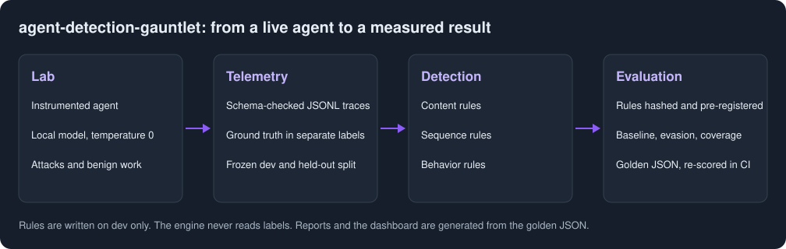

# agent-detection-gauntlet

Measures which AI-agent detection techniques stay effective when attackers deliberately evade them.

Live demo: https://NoLearningManJustExecute.github.io/agent-detection-gauntlet/

Third of a trilogy: [rag-attack-lab](https://github.com/NoLearningManJustExecute/rag-attack-lab)
attacks, [agent-risk-framework](https://github.com/NoLearningManJustExecute/agent-risk-framework)
defends, and this one detects.

> Which AI-agent detection techniques remain effective when attackers intentionally evade them?

**Homoglyph and zero-width characters blind keyword detection, while sequence and behavior detection
hold.**

Pooled over payload mutations, guardrails off. Recall is over attacks that still succeeded, which was
138/396 runs, or 57 distinct succeeded traces in 17 groups:

| Tier | Recall under payload mutation | Same attacks, unmutated | Change [95% interval] |
|---|---|---|---|
| content | 7/57 = 0.123 | 25/48 = 0.521 | -0.398 [-0.604, -0.170] |
| sequence | 8/57 = 0.140 | 7/48 = 0.146 | -0.005 [-0.060, +0.047] |
| behavior | 21/57 = 0.368 | 20/48 = 0.417 | -0.048 [-0.092, +0.012] |
| all tiers | 28/57 = 0.491 | 39/48 = 0.812 | -0.321 [-0.531, -0.065] |

- **Homoglyphs and zero-width characters** take content recall to 0/21 and 1/23. Fullwidth characters
  did not move it, because the rules normalize them away.
- **"Hold" means no measurable drop,** not good recall: both pooled intervals include zero, and behavior
  and sequence still miss most of these attacks.
- **Base64 is not an evasion here.** It broke the attack: 0/66 runs succeeded in each encoding, because
  the model could not act on it. A model that can decode could change that.
- **Together, on clean held-out attacks,** all tiers catch 20/28 = 0.714 [0.529, 0.847] of successful
  attacks, with a false positive rate of 1/38 = 0.026 [0.005, 0.135] over both guardrail arms. That is a
  different population from the 39/48 above, whose attacks were chosen because they succeeded.
- **Individual rules are weak.** Pooled over clean or mutated attacks, no single rule clears the
  registered bar of 0.5 recall at 0.05 FPR; the best is 7/28 = 0.250. The strength is in the combination, and the combination still
  drops under mutation.

14 rules, 887 scored live evasion runs, one local model. Read the [findings](docs/findings.md) and the
[limitations](docs/limitations.md), or browse the [dashboard](https://NoLearningManJustExecute.github.io/agent-detection-gauntlet/dashboard.html).



## How it works

1. **Attack.** Known attack classes run against an instrumented agent, alongside benign work,
   including hard negatives such as legitimate sessions that read secrets and send messages.
2. **Telemetry.** Every run becomes a trace of schema-checked JSONL events, aligned with the
   OpenTelemetry GenAI conventions. Ground truth lives in a separate labels file.
3. **Detection.** A deterministic engine runs content, sequence and behavior rules over the traces. It
   never reads labels.
4. **Baseline.** Rules are hashed and pre-registered, then scored on a frozen held-out split.
5. **Evasion.** Payloads are mutated by fixed code and re-executed live, so the traces are what the
   agent really did. Attack variants run alongside and are kept separate.
6. **Coverage.** Per-technique results are computed from the scores, never declared.

Rules were never tuned after held-out results were seen. Every rate ships with its numerator and
denominator, undefined rates are null, and CI re-scores the golden results and fails on any difference.

## Scope and limits

- **One model, one author.** `llama3.1:8b` at temperature 0, with attacks and rules by one author.
  Results may not transfer.
- **Relatives across the split.** All 20 succeeded held-out groups have a relative in the dev split, so
  clean recall may be inflated, and no held-out group is free of this to test on.
- **Not measured.** Paraphrase and translation evasion, adaptive attackers, false positives under
  mutation, and real alert volume.
- **Exports are not live validated.** Sigma, KQL, SPL and ES|QL files are labeled "converted, not live
  SIEM validated". No SIEM or Sigma backend has run them, and most rules do not convert
  ([export.md](docs/export.md)).
- **Mappings.** Rules map to MITRE ATLAS, OWASP LLM, OWASP Agentic and, for host actions, MITRE ATT&CK.
  The IDs rules use were checked against primary sources; one is unverified, and OWASP LLM uses the
  2025 numbers ([mappings.md](docs/mappings.md)).
- **Not a product.** This is a local research tool with no live monitoring.

The full list is in [docs/limitations.md](docs/limitations.md).

## Reproduce

Requires Python 3.12 or later.

```sh
python3.12 -m venv .venv
# Windows: .venv\Scripts\activate
. .venv/bin/activate
pip install -e ".[dev]"
```

Check the rules, the registrations and every generated document against what is committed. None of this
reads a held-out trace or changes a file:

```sh
gauntlet validate-rules rules
gauntlet validation verify
gauntlet coverage build --check
gauntlet publish build --check
gauntlet publish numbers
```

Re-score the held-out traces and compare with the golden files. This is the only step that reads them.
Each run appends a row to `docs/heldout-log.md`, as every held-out read does. In PowerShell, set
`$env:GAUNTLET_SCORING_HELDOUT = "1"` first:

```sh
GAUNTLET_SCORING_HELDOUT=1 gauntlet validation score --check
GAUNTLET_SCORING_HELDOUT=1 gauntlet evasion score --check
```

Traces are committed, so scoring needs no model. Producing new traces needs the source lab,
[agent-risk-framework](https://github.com/NoLearningManJustExecute/agent-risk-framework), and a local
Ollama, which this repository does not include.

## Repository layout

| Path | Contents |
| --- | --- |
| `rules/` | The 14 detection rules, one YAML file each |
| `datasets/` | Frozen corpus, evasion inputs and traces, and synthetic test fixtures |
| `results/` | Golden JSON for the baseline, evasion and per-technique results |
| `docs/` | Findings, limitations, generated reports, dashboard, method and formats |
| `src/agent_detection_gauntlet/` | Schema, engine, rules, metrics, validation, evasion, coverage, export, publish |
| `tools/leak_guard.py` | Standalone guard against personal data, local paths and secrets |
| `tests/` | Test suite |

## Documentation

- [docs/findings.md](docs/findings.md): the write-up
- [docs/limitations.md](docs/limitations.md): what the numbers cannot tell you
- [docs/results-baseline.md](docs/results-baseline.md), [docs/results-evasion.md](docs/results-evasion.md),
  [docs/coverage.md](docs/coverage.md): full generated tables
- [docs/detections.md](docs/detections.md): the rule catalog
- [docs/mappings.md](docs/mappings.md): framework IDs and how they were checked
- [docs/preregistration.md](docs/preregistration.md), [docs/heldout-log.md](docs/heldout-log.md): the
  registrations and every held-out read
- [docs/methodology.md](docs/methodology.md), [docs/metrics.md](docs/metrics.md),
  [docs/engine.md](docs/engine.md), [docs/schema.md](docs/schema.md),
  [docs/rule-format.md](docs/rule-format.md), [docs/dataset.md](docs/dataset.md),
  [docs/export.md](docs/export.md): method and formats
- [docs/demo.md](docs/demo.md): demo script and recording guide
- [ROADMAP.md](ROADMAP.md), [SECURITY.md](SECURITY.md), [CONTRIBUTING.md](CONTRIBUTING.md)

## License

MIT. See [LICENSE](LICENSE).
